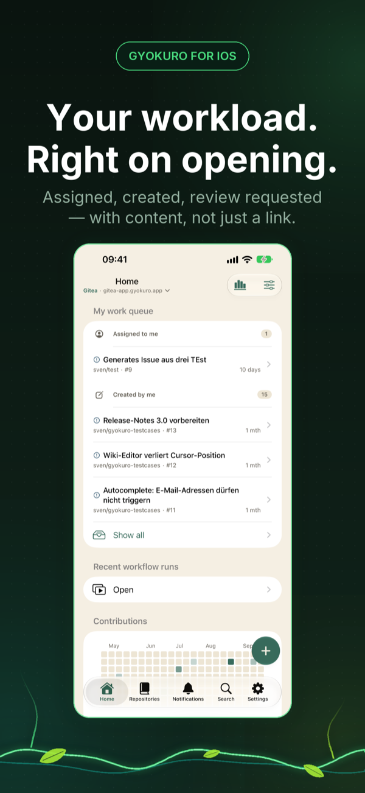
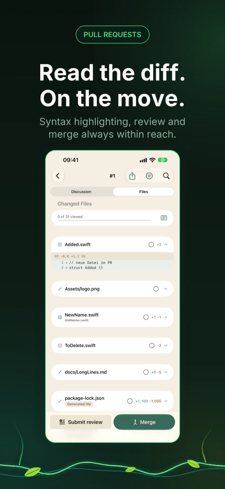
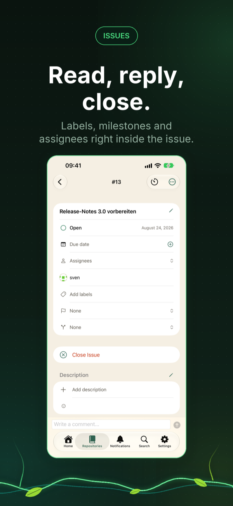
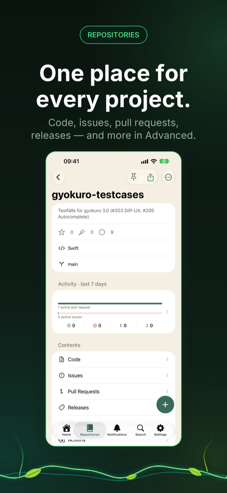
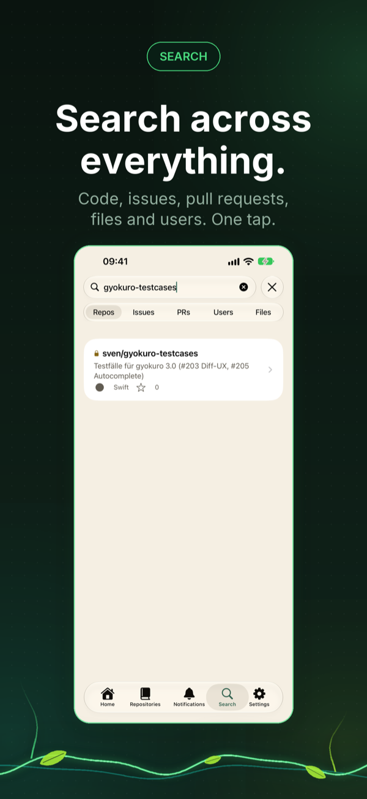
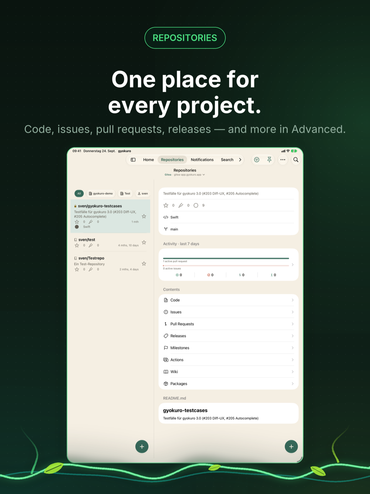

  

<h1 align="center">gyokuro</h1>

<strong>Your Gitea and Forgejo, in hand.</strong>

  A native SwiftUI client for <a href="https://about.gitea.com">Gitea</a> and <a href="https://forgejo.org">Forgejo</a> — code, issues, pull requests, releases and Actions from your self-hosted server, on iPhone and iPad.

  <a href="https://apps.apple.com/app/id6767816893?pt=128697224&ct=github-readme&mt=8">Download on the App Store</a>
  ·
  <a href="https://www.gyokuro.app/en/">Website</a>
  ·
  <a href="https://www.gyokuro.app/en/changelog/">Changelog</a>
  ·
  <a href="https://github.com/apps4selfhosted/gyokuro/releases">Releases</a>
  ·
  <a href="https://github.com/apps4selfhosted/gyokuro/issues">Report an issue</a>

---

> gyokuro is an independent, unofficial community client. It is not part of the official
> Gitea or Forgejo projects — with respect and thanks to the team that builds and maintains it.

## Screenshots

<table>
  <tr>
    <td align="center"></td>
    <td align="center"></td>
    <td align="center"></td>
    <td align="center"></td>
    <td align="center"></td>
  </tr>
  <tr>
    <td align="center">Home</td>
    <td align="center">Review</td>
    <td align="center">Issue</td>
    <td align="center">Repository</td>
    <td align="center">Search</td>
  </tr>
</table>

 iPad

## What it does

Code, issues, pull requests, releases and CI — straight from your pocket. gyokuro is the native
iOS client for your Gitea or Forgejo server. Fast, private, no third-party detours.

**Issues.** Read, comment, close and reopen. Labels, milestones and assignees right from the issue,
filters that are remembered per repository, bulk edits and time tracking.

**Pull requests.** The full diff with syntax highlighting, reviews with inline comments, and
everything the discussion needs on the go.

**Gitea Actions.** Workflow runs with their status, complete job logs and re-run for failed jobs —
no browser needed.

**Releases, wiki and code.** Browse versions and download assets, create releases with notes,
read and edit wiki pages, and change files with a code editor that commits directly.

**Instance administration.** For admins: a dashboard with key metrics, user management, runners
and jobs, maintenance and repository settings such as visibility, mirror and transfer.

**Made for homelabs.** Several accounts, self-signed certificates, custom headers and client
certificates — so gyokuro reaches servers that sit behind a reverse proxy or in your LAN. Widgets
show open issues on your home and lock screen, and the share sheet sends images, links or
screenshots from any app straight into a new issue.

**Privacy without compromise.** gyokuro talks to your server and nothing else. No analytics SDKs,
no ad networks, no tracking pixels. Tokens and passwords live encrypted in the iOS Keychain.

## Requirements

- A running [Gitea](https://about.gitea.com) or [Forgejo](https://forgejo.org) server and an access token
- iOS / iPadOS 17.6 or later
- Free download. gyokuro Unlimited is available as a yearly or monthly subscription, or as a one-time lifetime purchase.

## Support

This repository is the public place for bug reports and feature requests:

- 🐞 [Report a bug](https://github.com/apps4selfhosted/gyokuro/issues/new?template=bug_report.yml)
- 💡 [Request a feature](https://github.com/apps4selfhosted/gyokuro/issues/new?template=feature_request.yml)
- ❓ [Frequently asked questions](https://www.gyokuro.app/en/faq/)

Prefer not to post publicly? The [support form](https://www.gyokuro.app/en/support/) reaches the
same place privately. Replies usually within one to two days.

The app's source code is not hosted here — this repository exists for support, documentation and
releases.

## Related apps

Other native iOS clients for self-hosted services, by the same developer:
[Mobile MA](https://www.mobile-ma.app/) (Music Assistant) ·
[dock-g](https://www.dock-g.app/) (Dockge) ·
[BookStax](https://www.bookstax.app/) (BookStack) ·
[picaroa](https://www.picaroa.app/) (PicoShare) ·
[DockTrace](https://www.docktrace.app/) (Dozzle)

---

© 2026 Sven Hanold · Apps4Selfhosted

